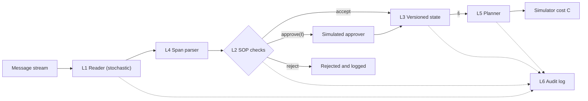

# The Price of Misread Operational Messages

Supplementary code, data and run records for the paper *The Price of Misread Operational
Messages: Evaluating Language Models by the Decisions They Feed*, submitted for double-blind
review.

Every table, figure and reported number in the paper can be recomputed from the files in this
repository on a laptop. No language model, GPU or network access is needed: the model replies
are recorded, and the checks below re-decide and re-price them. The full set of checks takes
under ten minutes.

**Contents:** [The method in brief](#the-method-in-brief) ·
[Quick start](#quick-start) ·
[Where each result comes from](#where-each-result-comes-from) ·
[Data](#data) ·
[Run records](#run-records) ·
[Protocols fixed before the runs](#protocols-fixed-before-the-runs) ·
[Re-running the language models](#re-running-the-language-models-optional) ·
[Names in the code and in the paper](#names-in-the-code-and-in-the-paper) ·
[Repository layout](#repository-layout)

## The method in brief

A language model, the **reader**, turns each operational message (a supplier notice, quality
hold, capacity cut or carrier delay) into a **typed change** to the planning data, a *delta*.
Deterministic checks complete and admit each delta, a versioned state records it, and a fixed
planning model, the **planner**, decides from that state. The model never decides.



Because each reading error is one recorded delta, total regret splits into the cost of
misreading and the cost of letting a model decide (Section 3.2 of the paper):

```math
\underbrace{C(x^\pi(\hat s)) - C(x^\star)}_{R_\text{total}}
= \underbrace{C(x^\pi(\hat s)) - C(x^\pi(s^\star))}_{R_\text{interp}}
+ \underbrace{C(x^\pi(s^\star)) - C(x^\star)}_{R_\text{dec}}
```

where $`\hat s`$ is the state as the reader read it, $`s^\star`$ the true state, $`x^\pi`$ the
planner's orders and $`x^\star`$ the benchmark policy. Each error is then priced by repairing it in
the recorded output and replaying the decision (single repairs and sampled Shapley values,
Section 3.4). [docs/architecture.md](docs/architecture.md) and
[docs/evaluation.md](docs/evaluation.md) describe each layer and the metrics.

## Quick start

Python 3.11 or later.

```bash
git clone https://github.com/incognito-research-studio/price-of-misread-messages.git
cd price-of-misread-messages
python -m venv .venv && source .venv/bin/activate
pip install -e ".[dev]"

make check     # lint, strict type checks and 208 tests (about 30 s)
```

Then recompute the paper's results from the shipped records. None of these commands calls a
model:

```bash
# Tables 4 and 5, and the pilot cost concentration (under 1 s)
python scripts/paper_numbers.py icores-final-readers-para-r2 \
    icores-final-readers-template-r2 icores-final-deciders-para

# Table 6, the pre-specified fresh-stream comparison, with the frozen analysis (about 4 s)
python scripts/replication_analysis.py runs/icores-replication-para data/v2/confirm-para

# Section 5.3 (Shapley values), ignoring the messages, buffer sensitivity (under 1 s)
python scripts/revision_numbers.py icores-final-readers-para-r3-shapley \
    icores-final-no-update-para icores-final-deciders-para icores-sens-buffer-0.1 \
    icores-sens-buffer-0.2 icores-sens-buffer-0.4 icores-sens-buffer-0.5

# Section 5.5, the hand-written challenge set (under 1 s)
python scripts/challenge_analysis.py runs/icores-challenge \
    runs/icores-final-readers-para-r3-shapley runs/icores-final-readers-template-r2

# Figs. 2 and 3, printed as pgfplots source (under 1 s each)
python scripts/concentration_figure.py icores-final-readers-para-r3-shapley shapley \
    icores-replication-para
python scripts/error_price_figure.py icores-final-readers-para-r3-shapley icores-promising-v1-surge
```

Two further checks rebuild results from the readers' recorded output instead of reading stored
results:

```bash
# Re-decide every reader's recorded output with the planner and compare cost, R_interp, F1,
# single repairs and Shapley values with the recorded run; ends with "none" (about 50 s)
python scripts/replay_check.py runs/icores-final-readers-para-r3-shapley \
    runs/icores-export-merged-para data/v2/pilot-para

# Table 7: score the same recorded output under order promising (about 1.5 and 2.5 min),
# writing to new folders, then compare them with the shipped runs
python scripts/promising_run.py runs/icores-final-readers-para-r3-shapley \
    runs/icores-export-merged-para data/v2/pilot-para configs/promising/promising-v1.yaml \
    runs/check-promising-v1
python scripts/promising_run.py runs/icores-final-readers-para-r3-shapley \
    runs/icores-export-merged-para data/v2/pilot-para configs/promising/promising-v1-surge.yaml \
    runs/check-promising-v1-surge
python scripts/promising_report.py runs/icores-final-readers-para-r3-shapley \
    runs/icores-promising-v1 runs/icores-promising-v1-surge
```

These commands were checked from a clean install on Python 3.11 (numpy 2.4.6, scipy 1.17.1,
pydantic 2.14.1); the recorded runs were made on Python 3.13 (numpy 2.5.4, scipy 1.18.1).

**One known small difference.** `promising_report.py` and the notes in `docs/research/` print
bootstrap intervals that can differ slightly from the paper's (regex on the pilot: [−297, 2,914]
against Table 5's [−280, 2,906]). Both use 10,000 stream resamples with seed 0, but
`paper_numbers.py` draws every condition from one shared generator, so the draws differ.

## Where each result comes from

Run folders are under `runs/`.

| Paper | Run folders | Scripts and records |
| --- | --- | --- |
| Fig. 1, the pipeline | none | `src/cdd/` (one module per layer; see [Repository layout](#repository-layout)) |
| Table 1, delta types | none | `src/cdd/schema.py`; `cdd schema` prints the JSON Schema |
| Table 2, error kinds | none | `src/cdd/evaluation/` |
| Table 3, calibration | `calibration/b2-*.json` | `cdd.benchmark.calibration` |
| Section 3.4, Shapley seed check | `icores-shapley-seed1-pilot`, `icores-shapley-seed1-fresh` | `scripts/shapley_seed_replay.py`, `scripts/shapley_seed_compare.py`; comparisons in each folder's `compare.txt` |
| Table 4, model deciders | `icores-final-deciders-para`; base-stock baseline in `icores-final-deciders-para-basestock` | `scripts/paper_numbers.py`, `scripts/revision_numbers.py`, `scripts/basestock_baseline.py` |
| Table 5, readers on the pilot | `icores-final-readers-para-r2`, `icores-final-readers-template-r2` | `scripts/paper_numbers.py`; output saved in `icores-final-numbers-r2.txt` |
| Table 6, fresh-stream replication | `icores-replication-para` | `scripts/replication_analysis.py`; frozen output in `icores-replication-para.analysis`; protocol in [docs/research/replication-protocol.md](docs/research/replication-protocol.md); notes in [wp1-results.md](docs/research/wp1-results.md) |
| Section 5.2, quote-snapping replay | `icores-final-readers-para-r3-shapley-snap`, `icores-replication-para-snap` | `scripts/snap_ablation.py` |
| Section 5.2, ignoring the messages | `icores-final-no-update-para` | `scripts/revision_numbers.py` |
| Section 5.3 and Fig. 2, where the cost sits | `icores-final-readers-para-r3-shapley` (pilot), `icores-replication-para` (fresh) | `scripts/revision_numbers.py`, `scripts/concentration_figure.py` |
| Section 5.4, Fig. 3 and Table 7, order promising | `icores-promising-v1`, `icores-promising-v1-surge`, scored from `icores-export-merged-para` | `scripts/promising_run.py`, `scripts/promising_report.py`, `scripts/error_price_figure.py`; notes in [wp3-results.md](docs/research/wp3-results.md) |
| Section 5.5, hand-written challenge set | `icores-challenge`; output in `icores-challenge.analysis` | `scripts/challenge_analysis.py`; texts and freeze manifest in [docs/research/challenge/](docs/research/challenge/); notes in [wp2-results.md](docs/research/wp2-results.md) |
| Section 7, buffer sensitivity | `icores-sens-buffer-*`, `icores-replication-para-buffers` | `scripts/revision_numbers.py`, `scripts/buffer_ablation.py` |

[scripts/README.md](scripts/README.md) describes every script and its arguments.

## Data

The paper uses benchmark version b2, in `data/v2/`. Each file is one stream: a synthetic
inventory world, its sequence of messages and the gold deltas behind them.

| Folder | Streams | Used for |
| --- | --- | --- |
| `pilot` | 24, template text | Table 3; Table 5 (templates) |
| `pilot-para` | the same 24, paraphrased | Tables 4, 5 and 7; Sections 5.1 to 5.4 |
| `dev`, `dev-para` | 24 development streams | Table 3; tuning the planner's safety buffer and the base-stock baseline |
| `confirm`, `confirm-para` | 48 fresh streams | Table 6, the fresh-stream replication |
| `challenge` | 4 pilot streams, 59 hand-written messages | Section 5.5 |

The generator is deterministic. Gold deltas are drawn first and the text is written from them,
so the gold is exact by construction:

```bash
cdd generate --config configs/benchmark/pilot.yaml --out data/check-pilot
diff -r data/check-pilot data/v2/pilot && echo identical
```

Paraphrases were made by a model from outside the reader families and kept only if they passed
the checks in Section 4.3. The challenge texts were written by a person who saw only fact sheets
built from the gold deltas, never the templates, the parser or any reader output; a second
person verified each text. [docs/research/challenge/](docs/research/challenge/) holds the fact
sheets, the frozen texts (`rewrites.yaml`, writers and verifier identified by code only) and the
manifest recorded before any model read them.

## Run records

Each run folder holds:

| File | Contents |
| --- | --- |
| `results.jsonl` | one row per stream and condition: cost, regret parts, precision, recall and F1, violations, audit completeness |
| `summary.csv` | per-condition means |
| `errors.jsonl`, `errors.csv` | every delta error with its kind, type, single-repair effect $`\Delta C_j`$ and, where computed, Shapley value |
| `sensitivity.csv` | error counts and summed $`\Delta C_j`$ by delta type and error kind |
| `requests-<model>.jsonl` | every model request and reply, tagged with stream and condition |
| `proposals.jsonl` | each reader's completed deltas, parse failures and SOP verdicts, for replay without the model (export runs) |
| `config.json`, `models.json` | the resolved configuration; model names, digests, server version and decoding settings |
| `failed.json`, `skipped.json` | pairs that raised or could not run (empty in every run reported) |

Conditions are named as follows in the records:

| Condition in the records | Name in the paper |
| --- | --- |
| `oracle` | the oracle pipeline (gold deltas, planner) |
| `no-update` | ignoring the messages |
| `regex` | Regex |
| `qwen-json` | Qwen, free JSON |
| `qwen-json-constrained` | Qwen, constrained JSON |
| `llama-json-constrained` | Llama, constrained JSON |
| `qwen-atomic` | Qwen, typed questions |
| `laya-atomic` | Laya, typed questions |
| `qwen-llm-over-oracle-state` | Qwen, oracle state, JSON (model decider) |
| `qwen-decides-over-oracle-state` | Qwen, oracle state, typed (model decider) |
| `qwen-e2e` | Qwen, raw stream (model decider) |

`icores-export-merged-para/proposals.jsonl` combines the five-reader export with Laya's, keeping
the oracle records (identical in both) once:

```bash
{ cat runs/icores-export-readers-para/proposals.jsonl
  grep -v '"condition": "oracle"' runs/icores-export-laya-para/proposals.jsonl
} > merged-proposals.jsonl
```

## Protocols fixed before the runs

- **Fresh-stream replication.** The readers, prompts, schemas, SOP file, planner, analysis script
  and stream count were frozen by a version tag before any fresh stream was generated, with one
  primary comparison. [FREEZE.md](FREEZE.md) records the tags; the protocol and its one
  amendment (raising the count to 48, before generation) are in
  [docs/research/replication-protocol.md](docs/research/replication-protocol.md).
- **Planner buffer.** The safety factor (0.3) was tuned on the development streams only and fixed
  before any evaluation run. Only the sensitivity runs of Section 7 vary it, after the fact.
- **Order-promising parameters.** `configs/promising/promising-v1.yaml` and
  `promising-v1-surge.yaml` were fixed on development streams before any pilot promising run
  ([docs/research/promising-dev-check.md](docs/research/promising-dev-check.md)).
- **Challenge set.** The texts were frozen in the repository before any model or parser read
  them (see [Data](#data)).

The design of these three added studies (the replication, the challenge set and order
promising), written before any of them ran, is in
[docs/research/icores-revision-scope.md](docs/research/icores-revision-scope.md).
[CHANGELOG.md](CHANGELOG.md) lists every change to the harness, including the defects found and
fixed before the reported runs.

Comments in the configs, SOP files and code say "pre-registered" for "fixed in the repository
before the evaluation runs". As the paper states, no protocol was registered with an independent
registry.

## Re-running the language models (optional)

Not needed for any check above. The exact configurations are in `configs/experiments/icores-*.yaml`
and `local-*.yaml`; each run folder's `config.json` names the one it used. The models ran locally
at temperature 0 with a fixed seed through [Ollama](https://ollama.com) 0.40.3; each run's
`models.json` records the model digests to match. Laya needs the `laya` extra
(`pip install -e ".[laya]"`). For example:

```bash
ollama pull qwen2.5:7b-instruct
cdd -v run --config configs/experiments/icores-replication.yaml
```

The scripts that produced the shipped streams and runs (`scripts/wp1-overnight.sh` for the
fresh-stream replication, `scripts/icores-final.sh` for the pilot conditions) are described in
[scripts/README.md](scripts/README.md).

Model clients are plain Python objects named in the config; [docs/adapters.md](docs/adapters.md)
describes the two small interfaces, and [docs/plug-in.md](docs/plug-in.md) with
`examples/evaluate_your_own_reader.py` shows how to price your own reader or planner.

## Names in the code and in the paper

The code predates some of the paper's wording, and configs and frozen files were left unchanged:

| Paper | Code, configs and docs |
| --- | --- |
| reader | interpreter (`cdd.interpreters`, `interpreter:` in configs) |
| planner, planning model | solver (`cdd.solver`, `solver:` in configs) |
| typed change | delta |
| deterministic checks | L4 span parser and L2 SOP layer |
| cost of misreading, $`R_\text{interp}`$ | interpretation regret |
| cost of letting a model decide, $`R_\text{dec}`$ | decision regret |
| compiling (keeping reading apart from deciding) | the package name `cdd` |
| fixed before any evaluation run | "pre-registered" in comments |
| order promising | `cdd.promising`, `promising-*` configs |

The notes in `docs/research/` use the project's work-package labels: WP1 is the fresh-stream
replication, WP2 the hand-written challenge set and WP3 order promising.

## Repository layout

```text
.
├── FREEZE.md                 # freeze tags behind the pre-specified comparison
├── CHANGELOG.md              # every change to the harness, with dates
├── configs/
│   ├── benchmark/            # stream generator settings (pilot, dev, confirm = fresh streams)
│   ├── experiments/          # the exact run configurations (icores-*, local-*)
│   ├── promising/            # order-promising parameter sets
│   └── sop/                  # SOP rule files
├── data/v2/                  # the benchmark streams (see Data)
├── docs/                     # architecture, benchmark, evaluation, adapters, plug-in
│   └── research/             # study design, replication protocol, challenge set, results notes
├── examples/                 # price your own reader or planner
├── runs/                     # the run records behind the paper (see Run records)
├── scripts/                  # paper numbers, figures, replay and promising checks
├── src/cdd/
│   ├── schema.py             # delta types (Table 1)
│   ├── interpreters/         # L1 readers: oracle, regex, LLM JSON, typed questions
│   ├── parser.py             # L4 span parser
│   ├── sop.py                # L2 SOP checks and simulated approver
│   ├── state.py, update.py   # L3 versioned state and the update operator
│   ├── solver.py             # L5 planner (rolling-horizon MILP) and hindsight benchmark
│   ├── audit.py              # L6 audit log
│   ├── deciders.py           # model deciders (Table 4)
│   ├── simulator.py          # inventory simulator with common random numbers
│   ├── benchmark/            # stream generation and the calibration check
│   ├── evaluation/           # alignment, error kinds, metrics, regret, attribution
│   ├── promising/            # order promising (Section 4.5)
│   ├── experiments.py        # experiment runner and replay of recorded output
│   └── cli.py                # the `cdd` command
└── tests/
```

## License

Code and data are released under the [MIT License](LICENSE). Citation details will be added
after review.
